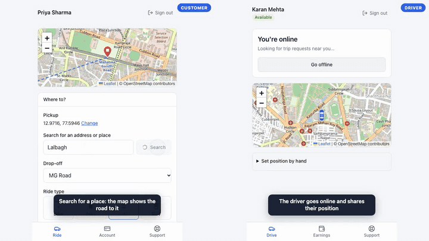

# ridehail-platform

A ride-sharing platform: a Spring Boot 3 (Java 21) API, an admin panel for operations, and customer and rider apps (Next.js web and Expo / React Native phone apps) on one shared, tested client.

[](docs/demo/ridehail-demo.mp4)

*The demo (under 3 minutes, with narration, [mp4](docs/demo/ridehail-demo.mp4)): a customer and a driver take a ride on live maps with the car moving, three requests arrive at the same moment, and the admin panel is toured. It is the real UI against the real API, recorded by [`scripts/demo`](scripts/demo) with simulated payments. The voice in the committed video is a system stand-in; [`scripts/demo`](scripts/demo/README.md) explains how to rebuild it with an ElevenLabs voice.*

[](https://render.com/deploy?repo=https://github.com/VaibhavBansal26/ridehail-platform)

## What is in it

| Part | Where | What |
|---|---|---|
| **API** | [`src/`](src) | Spring Boot 3, JPA, Flyway on Postgres, JWT roles `CUSTOMER` / `RIDER` / `ADMIN`, STOMP WebSocket |
| **Admin panel** | [`admin-web/`](admin-web) | Next.js: live map, trips, riders, payments, ledger, disputes, incidents, support, rider verification, audit log ([docs/ADMIN_PANEL.md](docs/ADMIN_PANEL.md)) |
| **Rider and customer web apps** | [`clients/apps/rider-web`](clients/apps/rider-web), [`customer-web`](clients/apps/customer-web) | Next.js, with maps (Leaflet), road routes, address search, vehicle pictures and live car tracking; sign-in cookies are held by the app's server, never by browser JavaScript |
| **Phone apps** | [`clients/apps/rider-mobile`](clients/apps/rider-mobile), [`customer-mobile`](clients/apps/customer-mobile) | Expo / React Native, tokens in the keychain, with the same maps, routes, address search and vehicle pictures (the map is a Leaflet page in a WebView: no native map library or key). **Tested and bundled, but not yet run on a device** |
| **Shared client** | [`clients/packages/api`](clients/packages/api) | Typed REST and realtime client with schema-checked responses ([clients/README.md](clients/README.md)) |

### What it does

- **Dynamic fares:** upfront quotes with demand and supply surge pricing, locked at booking.
- **Dispatch:** nearest-rider offers with timeouts; the rider accepts or declines. Live rider location for the customer.
- **Maps, routes and live tracking:** the customer searches for a destination by name, sees the pickup, destination and the **road** between them on a map, and watches the driver's vehicle (a bike, auto, sedan or SUV) move live; the driver sees every offer, and the trip, on a map. Several requests at once stack on the driver's screen, each on its own map. The admin map shows every driver as their vehicle. Search and routes go through the API ([docs/GEO.md](docs/GEO.md)); tiles come from OpenStreetMap by default (`MAP_TILE_URL` changes that).
- **Realtime:** offers, trip updates and rider location over WebSocket. One instance out of the box; many with RabbitMQ and Redis ([docs/SCALING.md](docs/SCALING.md), [docs/LIVE_LOCATION.md](docs/LIVE_LOCATION.md)).
- **Payments:** the card is charged when a trip ends; a double-entry ledger that must balance (enforced in the database); commission; refunds.
- **Rider payouts:** riders withdraw their share through Stripe Connect (Accounts v2, Express dashboard). A payout waits for the provider's settled funds rather than failing.
- **Disputes and provider problems:** chargebacks are recorded and the rider's share frozen until decided; text evidence is compiled and submitted from the admin panel; failed bank payouts, reversed transfers and failed refunds become incidents for a person ([docs/DISPUTES.md](docs/DISPUTES.md)).
- **Rider verification:** drivers upload licence, registration, insurance and a selfie (encrypted at rest); an admin approves them before they can go online.
- **Support chat:** customers and riders message support from the app; admins answer from the panel.
- **Push notifications:** offers, trip changes and support replies reach a closed app (Expo push; needs your Expo credentials).
- **Audit:** every administrator action is recorded in an append-only log.
- **Operations:** a production-shaped stack, Prometheus alerts for the things that cost money, backups with a restore drill, a load test and a runbook ([docs/DEPLOYMENT.md](docs/DEPLOYMENT.md)).

## Run it

You need JDK 21 and Maven; Node 24 for the web apps; Docker for the compose stack.

```bash
mvn spring-boot:run      # the API on :8080: in-memory H2, simulated payments, dev-only secrets
mvn test                 # 403 tests run (H2; plus tests against a real Redis, RabbitMQ and Postgres when Docker is available)
docker compose up --build   # TWO API instances + Postgres, RabbitMQ, Redis, an nginx gateway on http://localhost:8080 and the admin panel on http://localhost:3000
DEMO_DATA=true docker compose up --build   # the same, with a demo city loaded so the panel has something to show
```

The web apps (each reads `BACKEND_URL`; see its `.env.example`):

```bash
cd admin-web && npm ci && npm run dev                          # admin panel on :3000, sign in as admin / dev-admin-password
cd clients && npm ci && npm run dev --workspace ridehail-rider-web      # rider app on :3001
cd clients && npm run dev --workspace ridehail-customer-web             # customer app on :3002
```

Run the API with demo data (`mvn spring-boot:run -Dspring-boot.run.arguments=--ridehail.demo-data.enabled=true`) to get a populated city; demo accounts are `demo-customer-0` to `-17` and `demo-rider-0` to `-17`, password `demo-password-1`.

**Re-recording the demo video:** [`scripts/demo/README.md`](scripts/demo/README.md).

## Deploy it

- **A free demo on Render:** the button above uses [`render.yaml`](render.yaml): the API, admin panel, rider and customer web apps and a Postgres database, with Stripe test keys you enter in the dashboard. The runbook, and what the free tier costs you (sleeping services, a database that expires after 30 days), is in [docs/DEPLOYMENT.md](docs/DEPLOYMENT.md#deploying-on-render-a-free-demo).
- **Anywhere else:** every piece is a container and a few environment variables; [`docker-compose.prod.yml`](docker-compose.prod.yml) is the reference topology and [`.env.production.example`](.env.production.example) lists what it needs. The `prod` profile refuses to start without real secrets, and refuses the simulated payment gateway and the demo data.

## Stripe

Charges, refunds, Connect payouts and signed webhooks sit behind a `PaymentGateway` port; development and tests use a simulated gateway.

[docs/STRIPE_TEST_MODE_SETUP.md](docs/STRIPE_TEST_MODE_SETUP.md) is the test-mode setup and an end-to-end verification script. It was run against real Stripe in test mode: card saving, rider onboarding through Stripe's hosted page, a charge, a Connect transfer, a refund, a declined card and its recovery, a rejected API key and its retry without a double charge, and a payout that waits for funds. Not yet tried against real Stripe: answering a test dispute from the admin panel, and 3-D Secure cards.

## Database

Production schema is owned by Flyway (`src/main/resources/db/migration`). Beyond the tables it enforces the money rules in the database itself: the ledger is append-only and every ledger transaction must balance at commit, there is at most one open payout per rider, and amounts and statuses are constrained. Dev and tests on H2 generate tables from the entities instead.

The same integration tests run against a real Postgres (migrations, schema validation, triggers, row locking) when you point them at one:

```bash
docker run -d --name pg -e POSTGRES_DB=ridehail -e POSTGRES_USER=ridehail -e POSTGRES_PASSWORD=ridehail -p 5432:5432 postgres:16-alpine
RIDEHAIL_TEST_PG_URL=jdbc:postgresql://localhost:5432/ridehail mvn test   # the Postgres-only tests run too
```

## Tests and CI

| Suite | Tests |
|---|---|
| API (`mvn test`) | 403 run (76 more are skipped unless Docker or Postgres is available) |
| Admin panel | 124 |
| Rider web / customer web | 149 / 127 |
| Rider phone app / customer phone app | 79 / 59 |
| Shared client | 80 |

[CI](.github/workflows/ci.yml) runs the API tests on H2 and on a Postgres service container; checks the admin panel and the web apps (lint, types, tests, production build); bundles both phone apps for iOS and Android; runs a whole ride through the shared client against the running API; builds every Docker image; and brings up the two-instance compose stack to check that realtime and rate limits work across instances (`scripts/verify-realtime.py`). The API's `ClientApiContractTest` fails if a response stops matching the fixtures the clients parse.

## Documentation

| | |
|---|---|
| [docs/DEPLOYMENT.md](docs/DEPLOYMENT.md) | The runbook: what runs, what was proven, first-deployment checklist, Render demo, rider verification, support chat, backups, alerts, incidents |
| [docs/STRIPE_TEST_MODE_SETUP.md](docs/STRIPE_TEST_MODE_SETUP.md) | Stripe test-mode setup, webhooks, the verification script, known gaps, going live |
| [docs/ADMIN_PANEL.md](docs/ADMIN_PANEL.md) | What the admin panel shows and how it is secured |
| [docs/DISPUTES.md](docs/DISPUTES.md) | Chargebacks, evidence and finance incidents |
| [docs/SCALING.md](docs/SCALING.md) | Running more than one API instance |
| [docs/GEO.md](docs/GEO.md) | Address search and road routes: the endpoints, providers, limits and caching |
| [docs/LIVE_LOCATION.md](docs/LIVE_LOCATION.md) | How live rider location works |
| [clients/README.md](clients/README.md) | The shared client, the contract fixtures, and each app |

## Before real users

Everything under "Known gaps" in the Stripe document. Beyond that, honestly: the phone apps have not run on a device; push needs Expo credentials; the maps, address search and road routes use OpenStreetMap's **public** servers by default (fine for a demo, against their usage policies at scale: see [docs/GEO.md](docs/GEO.md)); the phone maps load Leaflet from a CDN and need the network; and rider documents and support messages have no retention policy yet.
